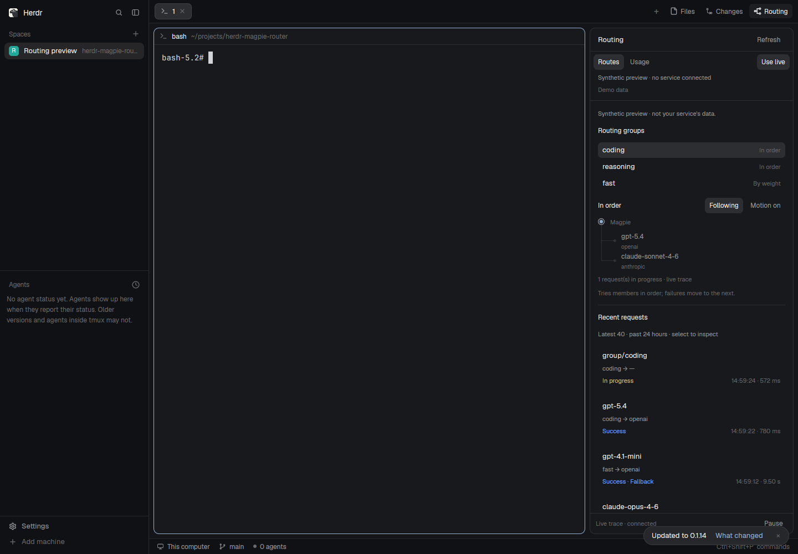
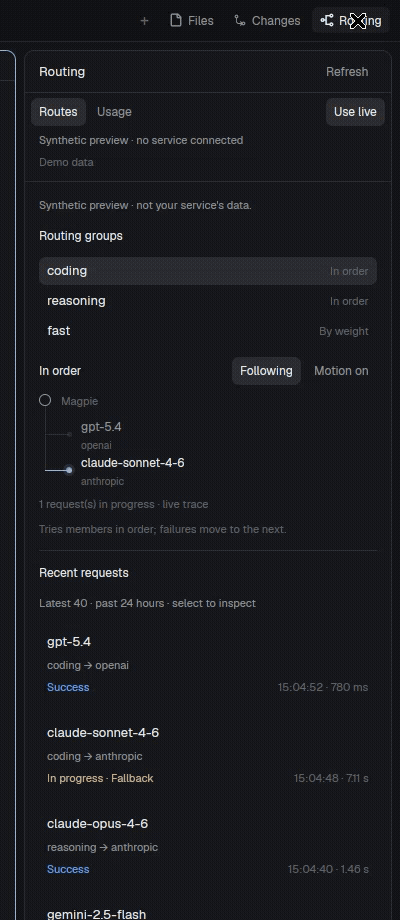

# Herdr · Magpie Router

在 Herdr 的 **Files、Changes 右侧添加 Routing 按钮**，开关指定 Magpie 服务的实时路由与用量面板。采用 Herdr 默认主题，中央终端继续保留。

启动本地桥接，安装面板后，在 **Routing → Connection** 填写 Magpie 服务地址和 Web key。支持测试连接、保存后立即切换及重启恢复。完整安装说明见 [右侧面板](docs/sidebar.md)，配置说明见 [连接设置](docs/connection.md)。



直接阅读 Magpie 本地源码并移植其 `poll()` / `play()` 生命周期：光点发送到模型后等待真实完成状态，失败返回后跟随下一次尝试，成功返回后清理。使用 `seq` 游标长轮询，支持并发请求、隐藏后追赶和网关重启。详见 [源码与动效语义](docs/routing-motion.md)。



## 开始使用

需要 Node.js 22 或更新版本，运行时没有第三方依赖。

```sh
git clone https://github.com/DylanLIiii/herdr-magpie-router.git
cd herdr-magpie-router
npm start
# 按下方步骤安装面板，再在 Routing → Connection 配置服务地址和 Key
```

原生侧边栏默认实时模式；Demo 按钮提供明确标识的合成数据预览。保留的网页伴侣可在 <http://127.0.0.1:4317> 独立打开，默认演示模式。

| 地址 | 用途 |
| --- | --- |
| `http://127.0.0.1:4317/?mode=demo` | 合成数据预览 |
| `http://127.0.0.1:4317/?mode=live` | 本机 Magpie 数据 |
| `http://127.0.0.1:4317/?mode=live&embed=1` | 网页紧凑模式，隐藏独立导航 |

## 能看到什么

- 路由分组、实际模型、Provider 之间的对应关系。
- 最近请求的结果、耗时、可用的 token 用量和尝试记录。
- 独立实时 trace 链路展示选择、发送、等待、回退和完成；最多四个并发光点，更多请求保留在列表。
- Usage 沿用 Magpie 的周期、输入/输出堆叠趋势、缓存计入开关、缓存命中率、模型与 Agent 用量、报告成本。
- 网页伴侣另提供请求搜索、时间窗口与状态筛选、详情检查、JSON 导出。
- 演示、实时、尚未配置、断连、空结果等状态。

展示范围受 Magpie 上游返回的记录和字段限制；未提供的测量显示 `—`。实时失败时保留明确的断连状态，不切回演示数据。Provider 状态基于最近可见尝试，不代表独立健康探测。

## 连接 Magpie

在 **Routing → Connection** 设置 **Magpie Web URL** 和 **Web access key**，可先 Test connection，再 Save & connect。Key 用密码框输入，仅保存在本机桥接的私有配置文件，不回显已存值；更换地址需要提供新 Key。保存立即作用于 Routing 和 Usage。

同一地址留空 Key 会保留原值。`.env` 仍可作为初始配置，已保存连接优先。详见 [连接设置](docs/connection.md) 和 [接口说明](docs/integration.md)。

## 安装到 Herdr

```sh
npm run install:panel
herdr-app check ~/.config/herdr-app/mods/magpie-panel
herdr-app do layout.clone --name main --as main-magpie
npm run attach:panel
herdr-app check ~/.config/herdr-app/mods/magpie-panel-tabs
```

安装面板，并复制目标机器的自带 tabs Mod，在 Changes 后加入 Routing。Routing 与 Files/Changes 共用右侧区域，点击再次关闭。Herdr 保护自带布局，因此在 `main` 的个人副本上操作。原文件、设置和快捷键保持原样，布局修改前会备份。参见 [安装与升级](docs/sidebar.md) 和 [实时验证](docs/live-routing-verification.md)。

`mods/magpie-dashboard/` 是当前侧边栏实现，安装器默认将它安装为 `magpie-panel`。早期的 `mods/magpie-router/` 侧栏与 `install:layout` 整页版本保留兼容；本次所需的右侧面板使用 **`install:panel`**。

## 开发与验证

```sh
npm install
npm run check
npm test
npx playwright install chromium
npm run test:ui
```

如果已有 Chromium，可以设置 `PLAYWRIGHT_CHROMIUM_EXECUTABLE=/path/to/chrome`。测试覆盖上游数据适配、凭据隔离、远端只读边界、本机配置保存和主要界面操作。

主要目录：`public/` 是浏览器界面，`server/` 是本地只读数据桥，`mods/magpie-dashboard/` 是当前原生面板，`scripts/install-panel.js` 负责安装，`test/` 是测试，`docs/` 是接口说明与原生截图。

这是一个社区集成，使用 [Herdr](https://github.com/herdrdev/herdr-app) 的原生 GPUI Mod 接口，读取 [Magpie](https://github.com/yetone/magpie) 的路由与用量 API。本项目代码按 [MIT License](LICENSE) 开源；来自 Magpie 的状态机与用量逻辑保留原作者 MIT 声明，安装时复制的 Herdr 标签栏遵循 Apache-2.0，详见 [第三方声明](THIRD_PARTY_NOTICES.md)。预览使用合成数据；不会发布服务凭据或真实账户截图。
