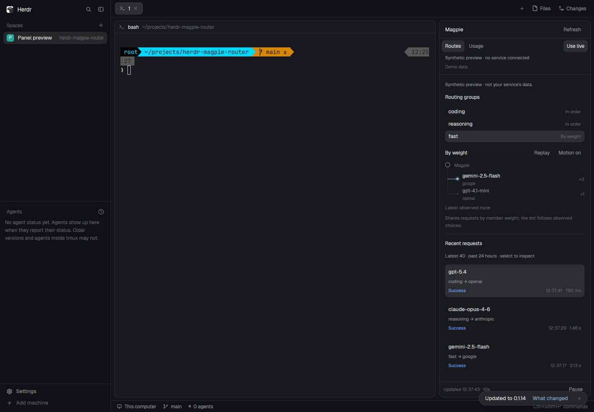
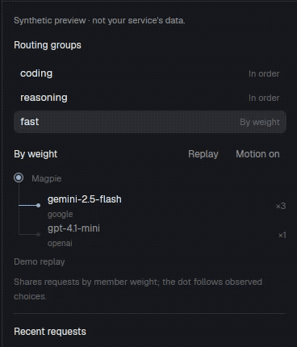

# Herdr · Magpie Router

在现有 Herdr 窗口的右侧查看指定 Magpie 服务的路由和用量。原生侧边栏默认宽度 368px，采用 Herdr 默认 Files / Changes 面板的样式，跟随明暗主题。

在 `.env` 设置 `MAGPIE_WEB_URL` 和 `MAGPIE_WEB_KEY`，启动本地桥接后运行 **`npm run install:panel`**。复制默认工作区并挂载面板后，侧栏与中央终端同时显示。完整安装、端口与认证说明见 [右侧面板](docs/sidebar.md)。



平铺的模型节点与一个原生小光点显示路由去向；权重、轮询、顺序和回退保留各自语义。支持历史回放和静态模式，详细说明见 [路由动效](docs/routing-motion.md)。



## 开始使用

需要 Node.js 22 或更新版本，运行时没有第三方依赖。

```sh
git clone https://github.com/DylanLIiii/herdr-magpie-router.git
cd herdr-magpie-router
cp .env.example .env
# 在 .env 配置 MAGPIE_WEB_URL 和 MAGPIE_WEB_KEY
npm start
```

原生侧边栏默认实时模式；Demo 按钮提供明确标识的合成数据预览。保留的网页伴侣可在 <http://127.0.0.1:4317> 独立打开，默认演示模式。

| 地址 | 用途 |
| --- | --- |
| `http://127.0.0.1:4317/?mode=demo` | 合成数据预览 |
| `http://127.0.0.1:4317/?mode=live` | 本机 Magpie 数据 |
| `http://127.0.0.1:4317/?mode=live&embed=1` | 网页紧凑模式，隐藏独立导航 |

## 能看到什么

- 路由分组、实际模型、Provider 之间的对应关系。
- 最近请求的结果、耗时、可用的 token 用量和尝试记录。
- 侧边栏展示配置的路由分组，以及 Today / 7 days / 30 days / All time 的用量、缓存 token 和报告成本。
- 网页伴侣另提供请求搜索、时间窗口与状态筛选、详情检查、JSON 导出。
- 演示、实时、尚未配置、断连、空结果等状态。

展示范围受 Magpie 上游返回的记录和字段限制；未提供的测量显示 `—`。实时失败时保留明确的断连状态，不切回演示数据。Provider 状态基于最近可见尝试，不代表独立健康探测。

## 连接 Magpie

复制 [.env.example](.env.example) 为 `.env`，配置后重启。凭据只由本地 Node.js 进程读取，不发送到浏览器。具体接口兼容性见 [integration.md](docs/integration.md)。

## 安装到 Herdr

```sh
npm run install:panel
herdr-app check ~/.config/herdr-app/mods/magpie-panel
herdr-app do layout.clone --name main --as main-magpie
npm run attach:panel
```

安装一个原生 Mod，并将它挂到默认布局副本的右侧。Herdr 保护自带布局，因此使用 `layout.clone` 保留默认界面后扩展。挂载前备份副本，已有面板不会重复添加；自带布局、设置和快捷键保持原样。参见 [安装说明](docs/sidebar.md) 与 [原生验证](docs/sidebar-verification.md)。

`mods/magpie-dashboard/` 是当前侧边栏实现，安装器默认将它安装为 `magpie-panel`。早期的 `mods/magpie-router/` 侧栏与 `install:layout` 整页版本保留兼容；本次所需的右侧面板使用 **`install:panel`**。

## 开发与验证

```sh
npm install
npm run check
npm test
npx playwright install chromium
npm run test:ui
```

如果已有 Chromium，可以设置 `PLAYWRIGHT_CHROMIUM_EXECUTABLE=/path/to/chrome`。测试覆盖上游数据适配、凭据隔离、只读边界和主要界面操作。

主要目录：`public/` 是浏览器界面，`server/` 是本地只读数据桥，`mods/magpie-dashboard/` 是当前原生面板，`scripts/install-panel.js` 负责安装，`test/` 是测试，`docs/` 是接口说明与原生截图。

这是一个社区集成，使用 [Herdr](https://github.com/herdrdev/herdr-app) 的原生 GPUI Mod 接口，读取 [Magpie](https://github.com/yetone/magpie) 的路由与用量 API。代码按 [MIT License](LICENSE) 开源。预览使用合成数据；不会发布服务凭据或真实账户截图。
