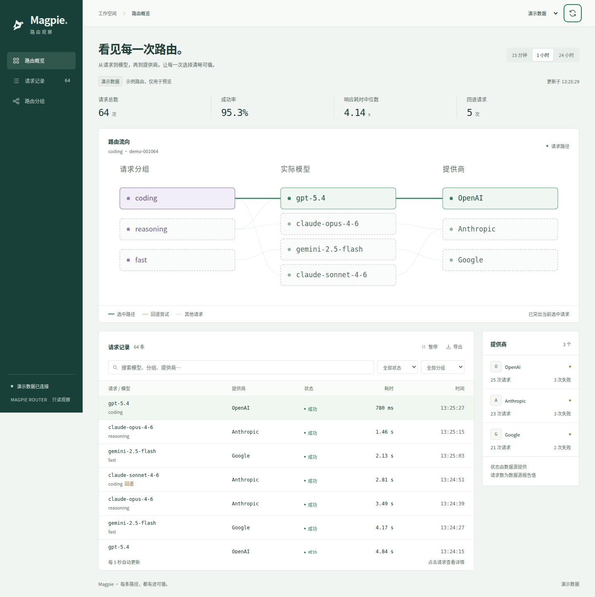

# Herdr · Magpie Router

让 Magpie 的每一次路由都有迹可循。一个可嵌入 Herdr 的只读 Mod，也可以作为独立网页运行。



## 开始使用

需要 Node.js 22 或更新版本，运行时没有第三方依赖。

```sh
cd /root/projects/herdr-magpie-router
npm start
```

打开 <http://127.0.0.1:4317>。默认显示明确标识的**演示数据**，不需要 Magpie 凭据。可在顶部切换数据源。

| 地址 | 用途 |
| --- | --- |
| `http://127.0.0.1:4317/?mode=demo` | 合成数据预览 |
| `http://127.0.0.1:4317/?mode=live` | 本机 Magpie 数据 |
| `http://127.0.0.1:4317/?mode=live&embed=1` | 网页紧凑模式，隐藏独立导航 |

## 能看到什么

- 路由分组、实际模型、Provider 之间的对应关系。
- 最近请求的结果、耗时、可用的 token 用量和尝试记录。
- 请求搜索、时间窗口与状态筛选、详情检查、JSON 导出。
- 最近路由中观察到的分组候选模型和 Provider 表现。
- 演示、实时、尚未配置、断连、空结果等状态。

展示范围受 Magpie 上游返回的记录和字段限制；未提供的测量显示 `—`。实时失败时保留明确的断连状态，不切回演示数据。Provider 状态基于最近可见尝试，不代表独立健康探测。

## 连接 Magpie

复制 [.env.example](.env.example) 为 `.env`，配置后重启。凭据只由本地 Node.js 进程读取，不发送到浏览器。具体接口兼容性见 [integration.md](docs/integration.md)。

## 安装到 Herdr

先读 [Mod 安装说明](mods/magpie-router/RECIPE.md)。`mods/magpie-router/main.js` 是实际的原生 GPUI 组件，首次发现默认停靠在右侧，宽度 400px，继承 Herdr 主题。网页伴侣用于独立查看；Herdr 原生组件直接读取同一个本地数据桥。

仓库不会自动修改你的 Herdr 布局或 Magpie 配置。已使用官方 Herdr App 0.1.10 临时发布包通过原生 `herdr-app check` 初始加载与渲染检查，也通过模拟宿主生命周期测试。目标机器仍应阅读自身版本的指南并再次运行检查；主题、异步状态与实际交互需在使用环境复查，详见 [原生安装与验收](docs/herdr.md)。

可以把以下指令交给 Herdr 中的 Agent：

> 先读取 `~/.config/herdr-app/AGENTS.md`，再读取这个仓库的 `mods/magpie-router/RECIPE.md` 和相关源文件，将 Magpie Router 作为只读面板加入我现有的布局。

## 开发与验证

```sh
npm install
npm run check
npm test
npx playwright install chromium
npm run test:ui
```

如果已有 Chromium，可以设置 `PLAYWRIGHT_CHROMIUM_EXECUTABLE=/path/to/chrome`。测试覆盖上游数据适配、凭据隔离、只读边界和主要界面操作。

主要目录：`public/` 是浏览器界面，`server/` 是本地只读数据桥，`mods/magpie-router/` 是 Herdr 接入组件与配方，`test/` 是测试，`docs/` 是接口说明与设计约束。

此仓库只在本地创建。公开发布到 Herdr Mods 目录时，需要自行推送到公开 GitHub 仓库并添加 `herdr-mod` topic，官方目录通常在一小时内收录。参考 [Herdr Mods](https://herdr.dev/mods/) 与 [Magpie](https://github.com/yetone/magpie)。
