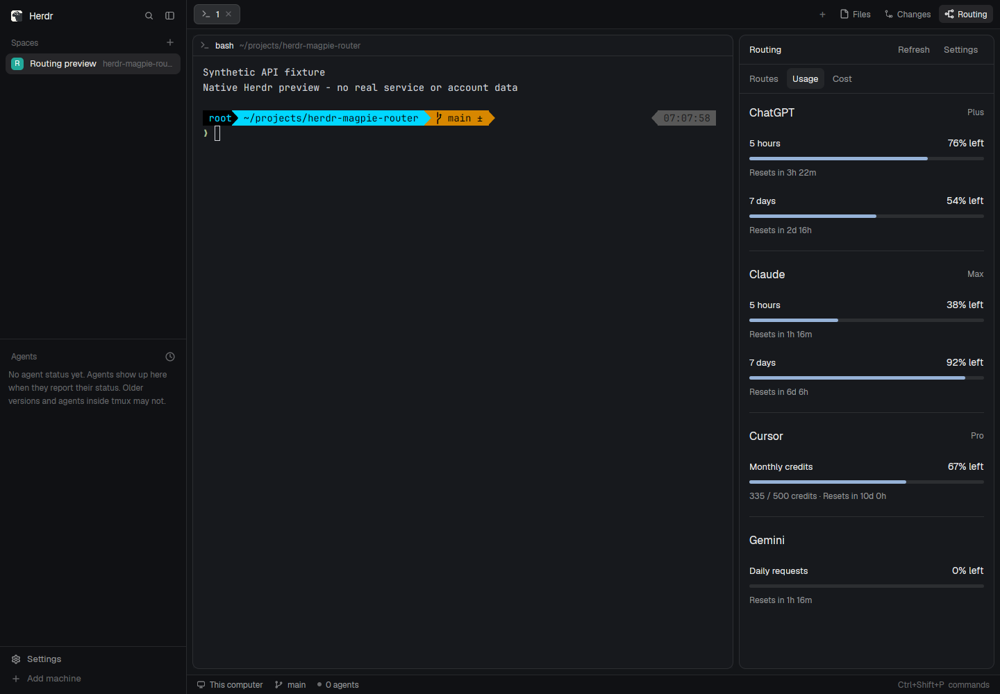

# Herdr · Magpie Router

在 Herdr 的 **Files、Changes 右侧添加 Routing 按钮**，打开 Magpie 的实时路由、订阅剩余额度和消耗统计。原生 GPUI 界面继承 Herdr 默认主题，中央终端继续保留。


打开即跟随所有请求，Motion 默认开启。无需选择路由组，没有 Demo 或 Pause；地址和连接配置只在 Settings 展示。

| 页面 | 内容 |
| --- | --- |
| **Routes** | Client → 路由组 → 模型的实时光点；成功、失败、回退和取消状态；占满剩余空间的请求列表，含耗时、token、缓存命中和详情 |
| **Usage** | 各 AI 服务订阅/计划的剩余额度、余额与重置时间，来自供应商经 Magpie 提供的额度接口 |
| **Cost** | Magpie 记录的请求、token、缓存命中及报告费用；周期选择、输入/输出图例、Models/Clients 分项 |



## 开始使用

需要 Node.js 22 或更新版本，运行时没有第三方依赖。

```sh
git clone https://github.com/DylanLIiii/herdr-magpie-router.git
cd herdr-magpie-router
npm start
```

另开终端安装面板：

```sh
npm run install:panel
herdr-app check ~/.config/herdr-app/mods/magpie-panel
herdr-app do layout.clone --name main --as main-magpie
npm run attach:panel
herdr-app check ~/.config/herdr-app/mods/magpie-panel-tabs
```

点击 **Routing → Settings**，填写 Magpie Web 服务地址和 Web access key，选择 **Test connection** 或 **Save & connect**。支持 `https://magpie.example/mac/` 这样的反向代理路径；必要时将内部 Web 端口填为 `3430`。

保存立即应用，重启恢复。Key 以掩码输入，只保存在本机桥接私有文件中，不回显已存值。完整说明见 [安装与升级](docs/sidebar.md) 和 [连接设置](docs/connection.md)。

安装器复制目标机器的 tabs Mod，在 Changes 后加入 Routing；Files、Changes 和 Routing 共用右侧区域。Herdr 保护自带布局，故安装在个人副本中并备份布局，保留原文件、设置和快捷键。已存在的 Mod 不会被覆盖，升级请使用新的安装名称。

## 数据与动效

读取 Magpie 本地源码并移植 `poll()` / `play()` 生命周期。`seq` 游标长轮询驱动原生光点：发送后等待上游完成，失败返回后跟随实际下一次尝试，成功返回收束，取消在目的地淡出。最多四个同时运动的请求，其他请求留在列表；新组到来不会打断已有请求。Settings 可关闭动效。

Usage 单独读取 `/api/usage/quotas`，不从 token 或费用推算订阅剩余额度。不同账号分别展示，不合计重叠的额度窗口；未知、无限、余额、暂缓读取和过期数据各自保留语义。Cost 是 Magpie 报告的成本，不是供应商发票。未提供的测量显示 `—`。

初次连接显示骨架屏；请求尚未返回时不显示连接错误。服务地址仅出现在设置中。所有远程访问均为 GET，本项目不修改 Magpie 的账户、路由或配置。

当前实现：`mods/magpie-dashboard/`。早期整页安装方式和浏览器伴侣保留兼容；浏览器入口 `http://127.0.0.1:4317` 也只读取实时数据，紧凑模式加 `?embed=1`。测试数据位于 `test/fixtures/`，生产接口不提供 Demo。

## 开发与验证

```sh
npm install
npm run check
npm test
npx playwright install chromium
npm run test:ui
```

已有 Chromium 时可设置 `PLAYWRIGHT_CHROMIUM_EXECUTABLE=/path/to/chrome`。详见 [本轮原生验证](docs/redesign-verification.md)、[动效语义](docs/routing-motion.md) 和 [接口说明](docs/integration.md)。

社区集成使用 [Herdr](https://github.com/herdrdev/herdr-app) 的 GPUI Mod 接口和 [Magpie](https://github.com/yetone/magpie) 的读取 API。本项目按 [MIT](LICENSE) 开源；Magpie 的 MIT 声明和 Herdr 的 Apache-2.0 声明见 [第三方声明](THIRD_PARTY_NOTICES.md)。发布截图均使用合成测试数据，不含真实凭据或账户。
