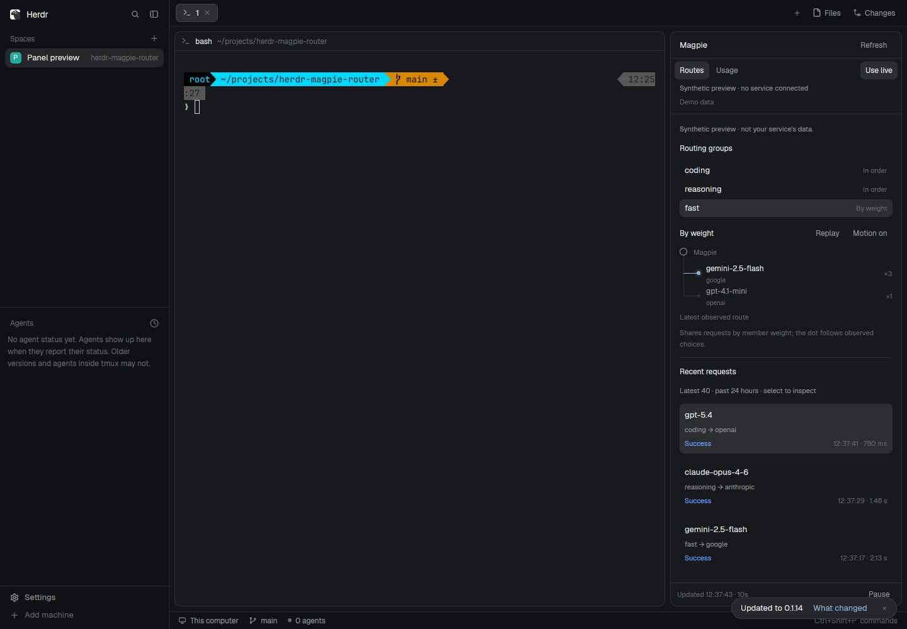

# Magpie right sidebar

A native Herdr sidebar for a chosen Magpie service. The familiar spaces list, tabs and terminal workspace stay visible; a 368px panel at the right shows routing groups, recent attempts and aggregate usage. Its appearance follows Herdr's default Files / Changes panels and the active light or dark theme.

## What you see

The panel has a 42px header with Magpie and Refresh, a compact Routes / Usage switch, a Demo/Live action, service origin and connection status. The scrolling body has 14px padding, 13px primary text and 11–12px metadata. Its background, text, border, hover and selected states use `theme()`. The outer frame has a 10px radius and 1px border; selected rows use a 7px radius like the shipped panels. No font or theme is set on the layout.

Routes shows groups in compact 28px rows, with a flat routing diagram underneath. A 6px theme-accent dot with a quiet 12px outer ring travels down a shared 1px rail and into one of up to four model nodes. The node list exposes configured weights and the strategy label; Replay and Motion on/off sit above it. Recent requests follow. Clicking a request replaces the panel body with details and Back to requests; terminals remain visible. Usage shows four period controls and aligned label/value rows for requests, errors, tokens, cache and cost, followed by model totals. A 36px footer carries the last update and Pause/Resume.

## How it behaves

Selecting a group changes its flat model destinations immediately. New observed attempts move the dot using native transitions (240ms vertical, 180ms horizontal); unchanged snapshots never create new traffic. Replay is explicitly marked as history or demo; Motion off keeps a static destination, and hidden/paused/offline states cancel movement. Selecting a request opens its model/provider, result, timing, token, fallback and attempt details. Success, failure and pending states use theme colors plus labels. Missing values are `—`; zeroes remain zero. Demo is explicitly synthetic and opt-in; live mode is the default.

Visible panels refresh every 10 seconds. Hidden panels stop automatic reads. Pause stops automatic refresh; manual Refresh still works. A 15-second watchdog pauses stalled fetches and ignores late responses. Failed refreshes retain timestamped stale data with an offline label. Mode/period changes discard old data so a late response cannot win.

Tab focuses controls; Enter/Space activates them. With the panel focused: G/U select Routes/Usage, R refreshes, Space pauses, D toggles demo, 1–4 select period, Up/Down select requests, Left/Right select groups, Enter expands a request and Escape returns to the list. No global shortcuts are installed.

## Built from

- `mods/magpie-dashboard/main.js`: native GPUI mod with a default sidebar presentation and an older optional page presentation. Uses `herdr.props()`, `theme()`, `layout()`, `nextCommand()`, `cx.spawn` and `cx.timer.every`. No HTML, CSS, web view or Node APIs inside the mod.
- `mods/magpie-dashboard/config.js`: local bridge endpoint and motion preference. The installed copy also records its mod name for visibility detection.
- `mods/magpie-dashboard/routing.js`: strategy labels, bounded flat destination projection and event-driven playback. The controller schedules only semantic transitions with one-shot timers; all interpolation runs natively. Real routing choices and fallback order come from observations, never a local routing simulation.
- `scripts/install-panel.js`: installs that source as `mods/magpie-panel/`, with `place: right`, `size: 368`, `focusable: true`; refuses overwrites.
- `herdr-app do layout.clone --name main --as main-magpie`: creates a personal copy of the default workspace and preserves its look/click settings.
- `scripts/attach-panel.js`: adds one block as the last child of the clone's `work-body` row, size 368px, min 280, max 640. It backs up the personal file, refuses shipped layout names and does not duplicate an existing panel.
- `server/dashboard.js`: fixed-origin authenticated reads of Magpie web groups, trace/history, request usage and full-period usage. Cookie authentication remains in the local bridge; only allowlisted display fields reach the mod. Remote records never mix with local history.
- `server/index.js`: local loopback bridge with Host/Origin checks and GET-only endpoints. The mod fetches `/api/dashboard` and runs no external programs or file reads.

## Watch out

Herdr protects shipped layouts. `mod.json` alone does not dock a new panel onto `main`; clone first and attach explicitly. `mod.open` creates a floating overlay, not a sidebar. Do not edit Herdr's shipped Files, Changes, tabs or main files.

The mod endpoint is the local bridge URL. The Magpie service URL and web key belong in `.env`. A gateway Bearer key does not authenticate the management web API. Reverse proxies or SSH forwarding may require `MAGPIE_WEB_COOKIE_PORT` to name the internal web listen port.

Layout props must come from `herdr.props()` on the checked host. GPUI fetch cannot cancel its underlying request; the watchdog cancels ownership, so a manual retry may overlap one stalled request. Do not retain a callback's `cx`.

The small diagram shows up to four flat model destinations, prioritizing observed targets; nested groups are not treated as responding models. Only direct configured members receive weight labels. The route sample is bounded to 500 in the bridge and 40 in the panel. Group configuration is bounded to 200 groups/100 members. Usage model detail shows the top 20; aggregate totals come from a separate API and are not computed from that sample. USD cost is reported for priced calls; it is not a subscription invoice. Without Intl support, periods use the service time zone.

## Done when

`npm run check`, `npm test` and `herdr-app check` pass. The panel is visibly docked to the right of the default-workspace clone with terminals still shown. Verify Routes, Usage, group selection, request detail/back, period selection, Pause/Refresh, dark/light themes and 320–368px widths in the native window. The installer preserves existing files; attachment protects shipped layouts, creates a backup and is idempotent. Then verify live data with the chosen service address and its locally configured web key.
