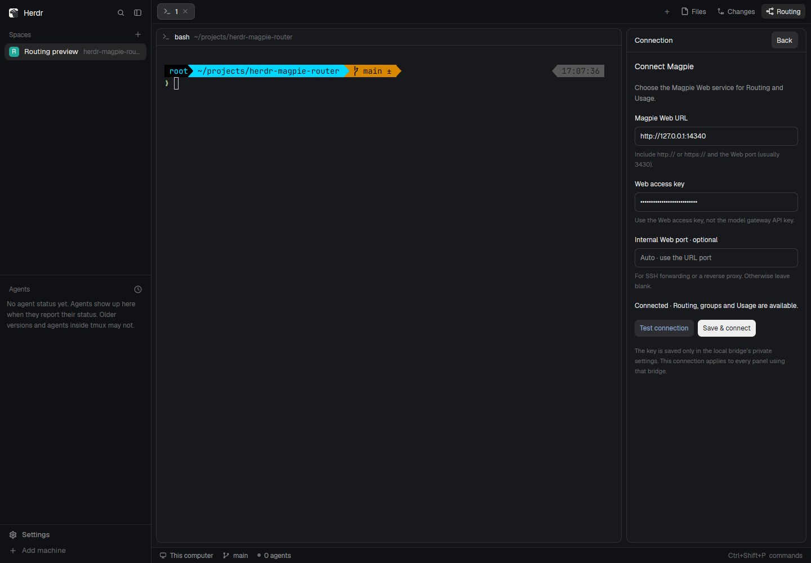

# 在 Herdr 中配置 Magpie 地址和 Key

打开 **Routing → Connection**，直接设置要连接的 Magpie 服务。首次使用不需要编辑 `.env`；本地 Node 桥接仍需运行。



1. **Magpie Web URL**：完整服务地址，例如 `http://192.168.1.20:3430` 或 `https://magpie.example`。使用 Web 服务端口，通常为 3430，而非通常为 3425 的模型网关端口。
2. **Web access key**：该 Web 服务的访问密钥（对应 `MAGPIE_WEB_RUNKEY` / 登录链接中的 Key），与模型网关 API key 不同。输入框默认掩码。
3. **Internal Web port**：通常留空。若通过反向代理或 SSH 转发访问，填写 Magpie 实际 Web 监听端口，用于正确的 `magpie_web_<port>` cookie 名。
4. **Test connection**：读取 Routing、Groups、Usage 三个接口，返回各项是否可用。测试不保存，也不切换当前服务。
5. **Save & connect**：保存配置并立即应用到 Routing 和 Usage，无需重启桥接或 Herdr。保存不会等待远端上线；若服务不可达，主面板显示连接错误。

保存后回到原面板，自动选择 Live。切换服务会清空旧路由、用量和缓存，并终止旧服务正在等待的 trace 请求。迟到的旧服务响应会被拒绝。

## 保存与更换 Key

重新打开 Connection 时，地址会回填，Key 字段保持为空，只显示“Key saved”。在**同一个地址**留空会保留已存的 Key；填写新 Key 会替换旧 Key。更改主机、协议或外部端口时必须提供新 Key，旧服务凭据不会自动发给其他服务。

Key 不放在 Mod 的 `config.js`、布局 props、`localStorage` 或 API 返回值中。它只通过保存请求发送给本机桥接，由桥接保存并用于远端认证；输入缓冲在保存、返回或销毁面板时清空。

默认持久化位置：

```text
$XDG_CONFIG_HOME/herdr-magpie-router/connection.json
# 未设置 XDG_CONFIG_HOME 时：
~/.config/herdr-magpie-router/connection.json
```

文件以原子写入方式保存，权限为 `0600`；这是受文件权限保护的本地文件，不是系统钥匙串加密存储。需要自定义位置时设置 `MAGPIE_CONNECTION_FILE`。不要将实际连接文件提交到公共仓库。

保存的连接优先于 `.env` 中的 `MAGPIE_WEB_URL` / `MAGPIE_WEB_KEY` / `MAGPIE_WEB_COOKIE_PORT`。未保存连接时仍兼容这些环境配置以及原来的网关模式。环境配置不完整时，桥接会启动并允许在 Connection 修正。

同一桥接仍只连接一个服务；多个面板使用同一个桥接时共享此配置。若另一面板在你编辑期间保存了新设置，保存操作会提示重新打开 Connection，以避免覆盖新配置。

## 本机设置接口

- `GET /api/connection`：地址、内部端口、是否已有 Key、修订号和本进程的设置 token。绝不返回 Key。
- `POST /api/connection/test`：测试输入配置，不持久化。
- `POST /api/connection`：保存并替换本机服务适配器。

写接口要求 loopback Host、允许的 Origin、JSON、配置 token 和匹配的修订号；跨站请求被拒绝。远程 Magpie 数据接口仍只有 GET，设置写入不修改 Magpie 路由或账户。上游错误正文不返回给面板。

如果看不到设置入口，更新 Mod；如果出现“Connection settings require an updated local bridge”，更新仓库并重启 Node 桥接。首次升级到这一版本需要加载新增代码，之后每次修改地址或 Key 都直接生效。

## 验证

已在 Herdr App 0.1.10 的隔离原生窗口中，用实际鼠标和键盘输入测试地址/Key、点击 Test、保存、连通实时 Routing，再打开表单确认 Key 不回显。桥接重启后恢复同一配置。

本轮 `npm run check` 通过，**70 项 Node 测试、6 项浏览器回归测试**全部通过，源码和已安装 Mod 通过 `herdr-app check`。新增测试也验证了设置请求超时后可以返回，并在再次写入前重新读取当前配置，避免保存结果不确定时重复覆盖。

- [测试通过，Key 掩码](previews/connection/tested-dark.png)
- [保存后连通 Routing](previews/connection/connected.png)
- [明色主题重新打开，Key 不回显](previews/connection/saved-light.png)

截图使用本机合成、带认证的 Magpie API fixture，不是用户的真实服务。自动化覆盖配置持久化/权限、原地址保留 Key、换地址必须新 Key、错误/并发保存、跨站写保护、原生输入和旧服务响应隔离。实际目标服务仍需用户填写地址及其 Key。
