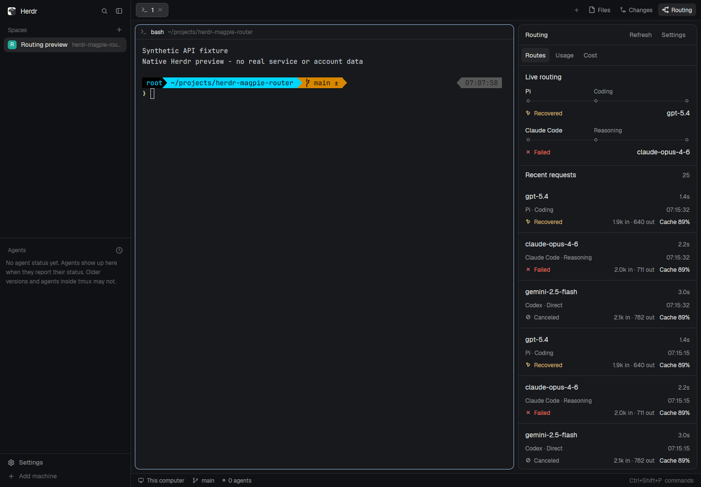

# Native live routing

The panel follows all requests automatically. Each lane identifies the Client, routing group (or Direct), and actual model. Up to four requests animate concurrently; extra active requests remain in the list and take a freed slot immediately. A newer request from another group does not cancel an existing packet.

## Source and lifecycle

Magpie was read from a real local Git checkout at `cd0ba05c216c924ef7f962c25111c0293814b45b`:

- `internal/gui/assets/plugins/routing/client.js`: `poll`, `play`, `home`, `stopPlays`.
- `internal/gateway/trace.go`, `internal/gui/trace.go`: sequence, attempts, completion and cancellation.
- `internal/gui/assets/plugins/usage/page.js`, `internal/usage/usage.go`: token/cache arithmetic, now presented as Cost.
- `internal/gui/usage.go`, `internal/provider/subscription_usage.go`, `internal/gui/assets/app.js`: subscription allowance reads and display semantics.

The bridge forwards `after` and `wait` to the actual trace endpoint. Upstream long polls can wait 25 seconds; the bridge allows 30 seconds. Epoch changes and cursor rollback reload the trace. Initial load or returning to a hidden panel animates unfinished requests only.

| State | Phase | Stage label | Native behavior |
| --- | --- | --- | --- |
| Selecting | `enter` / `selecting` | `Selecting` / `Retry N` | Wait at the client anchor (`start`) until an actual attempt exists |
| Routing to group | `to-rail` | `Routing` / `Rerouting` | Illuminate the ingress segment (`start` → `middle`) and trail a wake toward the group station |
| Dispatching to model | `to-model` | `Dispatching` / `Try N` | Illuminate the upstream segment (`middle` → `end`) and trail a wake to the model station |
| Running | `held` | `Generating` | Hold at the model station (`end`); pulse the packet core and 16px model halo over a 1200ms period until an actual attempt or request terminal frame arrives |
| Attempt result | `result` | `Complete` / `Recovered` / `Attempt failed` / `Canceled` | Lock the destination halo and color before returning or fading |
| Returning | `return-rail` → `home` | `Returning` → `Delivered` (or `Rerouting` → `Await retry`) | Retract the upstream segment and return through the group station; failed attempts wait at the client for the next actual try |
| Recovered | Subsequent attempt | `Retry N` / `Rerouting` / `Try N` / `Recovered` | Switch lane tone to `working` (amber), preserve the group recovery marker, and show a `Try N` badge |
| Canceled | `fade` | `Canceled` | Muted cancellation mark and fade in place without a return sweep |

Motion defaults to On and can be turned off in Settings. The header status bar surfaces `Motion off` when disabled, `+N queued` when more than four active requests are in flight, and `N active` with a 1200ms pulsing dot while requests are running. Polling and status display continue when motion is off. Switching views, hiding the panel or opening settings cancels local animations; returning catches up without replaying old completions.

## Rendering

Herdr's default theme supplies foreground, borders and semantic colors (`accent`, `done`, `working`, `blocked`, `muted`). Each 78px lane renders a 1px base rail across three stations (`client` at `start`, `group` at `44%` width, and `model` at `end`), two 2px active segments (`ingress` and `upstream`), a trailing `wake` bar, a 16px model `halo` ring, and a 10px outlined packet with a 4px core. Multi-attempt routes display a `Try N` badge next to the group label and amber recovery styling on the group station.

GPUI interpolates packet `left` and segment `width` with critically damped springs (`response: 210, damping: 1`), wake `left`/`width` with `spring({ response: 190, damping: 1 })`, and segment/wake/packet `opacity` with `ease-out` transitions (`160ms`, `140ms`, and `170ms`). The runtime exposes native position, width and opacity properties rather than CSS transforms, and JavaScript schedules request phases from real trace state rather than synthetic animation frames.

During `held` (and `selecting` on the packet core), `loop("opacity", { period: 1200 })` drives the active header dot (`0.36 → 1`), the model halo (`0.16 → 0.58`), and the packet core (`0.42 → 1`). Pending state never ends because a timer expired: either the matching attempt's terminal frame or the request's terminal success, error or cancellation frame releases `held`. The bounded native fetch watchdog prevents accumulation when the host fetch has stalled and cannot be aborted.

The graph gives priority to active requests. When idle it keeps the latest two routes, leaving most of the panel available to the independently scrolling request list. The list shows up to 80 records and includes Client, group, actual model, result, duration, input/output and cache hit. Missing measurements stay unknown.

## Cost and subscription Usage

Cost retains Magpie's `today`, `7d`, `30d`, `all` periods, cache inclusion, stacked input/output chart and Models/Clients breakdown. Cache hit uses `cache_read / (input + cache_read + cache_write - cache_unknown)` for aggregate totals; request-level unknown-cache attempts are excluded from the corresponding denominator. A legend labels each chart series.

Usage uses a separate `/api/allowances` bridge request and Magpie's `/api/usage/quotas` (or the gateway equivalent). Remaining share is `100 - used`, clamped for display. Text-only windows, balances and unlimited windows never become a synthetic 100% bar. Distinct accounts and overlapping windows are not summed. No quota is inferred from Magpie's token ledger or cost.

All public endpoints are live-only. Synthetic protocol samples and screenshots are test artifacts, documented in [verification](redesign-verification.md). No user credentials or account images are published.
